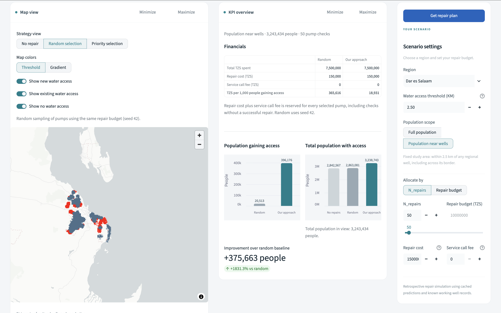

# Tanzania water access: prioritizing pump repairs

This proof of concept helps prioritize water-pump inspections and repairs in Tanzania under a limited budget. The goal is to increase the number of people with access to a working pump.

## The proposal at a glance

An interactive dashboard compares repair strategies within a selected region. Users can explore estimated access gains, costs, and a downloadable repair plan.



## Using the dashboard

Select a region, enter a number of pump checks or a financial budget, and set repair and service-call costs. Compare no repairs, random selection, and priority selection on the map. The KPI panel shows population gains, total access, and costs. **Get repair plan** downloads the prioritized wells, identifying details, and expected access increase as CSV.

## Approach and main findings

XGBoost predicts pump functionality using pump characteristics, nearby-well counts, and population-radius features. Selecting the most confidently nonfunctional pumps did not beat random selection in the initial access experiment. The priority strategy instead ranks pumps by expected additional people gaining access, accounting for overlapping catchments.

In the saved evaluation, validation accuracy was **79.4%**, compared with **45.6%** for a random classifier and **54.4%** for the majority-class baseline. In Morogoro, with 300 checks and a 2.5 km access threshold, simulated full-region coverage improved by **6.47 percentage points** under access prioritization, versus **1.18** for random selection and **1.02** for confidence-first selection. These are retrospective estimates from one experiment, not observed field outcomes.

## Evaluation methodology

Morogoro is excluded from model training and validation to assess performance in an unseen region. Regional feature-profile similarity informed this demonstration choice; it does not establish representativeness across Tanzania. Encoders and training-reference neighbor features are fitted only on training rows.

Access is estimated by summing population pixels within a configurable straight-line distance of a working pump. Results cover either the full region or a fixed 2.5 km catchment around candidate wells. Each comparison uses the same population denominator. Selected truly nonfunctional pumps are assumed successfully repaired; false positives consume checks without increasing access.

## Data and implementation

The project combines [DrivenData pump records and status labels](https://www.drivendata.org/competitions/7/), a [WorldPop population raster](https://hub.worldpop.org/project/categories?id=3) for 2026 at approximately 1 km resolution, and [Tanzania regional boundaries](https://github.com/wmgeolab/geoBoundaries/blob/9469f09/releaseData/gbOpen/TZA/ADM1/geoBoundaries-TZA-ADM1.geojson).

`src/water_wells` contains modeling, feature engineering, and access KPIs. `src/dashboard` contains the Streamlit app and CSV-cache generator. Each region's predictions come from a model trained without that region. Changing repair constraints recalculates selection and access using cached predictions; it does not retrain the model.

## Run the project

### Setup and input data

Use Python 3.10 or newer. From the repository root:

```bash
python -m venv .venv
source .venv/bin/activate
python -m pip install -r requirements.txt
```

The processed dashboard datasets and WorldPop raster are included in this repository, so the dashboard can run without downloading data or training models. The other raw inputs and intermediate caches are excluded from version control.

To rebuild the datasets or reproduce the analysis, download the inputs from the sources above and place them at these paths. Rename the competition downloads to match the expected filenames.

| Input | Local path |
| --- | --- |
| Training features | `4910797b-ee55-40a7-8668-10efd5c1b960.csv` |
| Training labels | `0bf8bc6e-30d0-4c50-956a-603fc693d966.csv` |
| WorldPop Tanzania, 2026, constrained 1 km, R2025A v1 | `tza_pop_2026_CN_1km_R2025A_UA_v1.tif` |
| Regional boundaries | `data/raw/geoBoundaries-TZA-ADM1.geojson` |

### Prepare and launch the dashboard

Launch the app using the included datasets:

```bash
python -m streamlit run src/dashboard/app.py
```

For Streamlit Community Cloud, select this repository and branch, set the entrypoint to `src/dashboard/app.py`, and use Python 3.12. The root `requirements.txt` installs the project and its dependencies. No secrets or data-download configuration are required.

To rebuild a cache for one region:

```bash
python -m dashboard.cache_data --regions "Dar es Salaam"
```

Omit `--regions` to prepare all regions. Existing CSV caches are reused; add `--refresh` after changing data or model settings. Generated files are saved under `data/processed/dashboard`. The first run includes training and geographic processing and takes longer than subsequent use.

### Reproduce the analysis and run tests

```bash
python -m jupyterlab
python -m pytest -q
```

Run notebooks in this order, using the project environment and a fresh session:

1. [Early exploration draft](notebooks/01_early_exploration_draft.ipynb): historical experiments before the reusable implementation; preprocessing precedes splitting in this prototype.
2. [Model evaluation](notebooks/02_model_evaluation.ipynb): current pipeline, baselines, geographic holdout, and cross-validation.
3. [Geographic and access experiments](notebooks/03_geographic_features_and_access_experiments.ipynb): population features, regional similarity, and repair-strategy comparison.

The full-data training test is optional: run `WATER_WELLS_FULL_TRAIN=1 python -m pytest -q tests/test_integration.py`.

## Limitations and next steps

The simulation assumes a known working-well inventory and successful repairs of selected nonfunctional pumps. Straight-line distance is an access proxy, not measured walking time or a validated 30-minute round trip. Pump capacity, queues, water quality, and seasonal reliability are not modeled; the population raster and pump records also represent different years.

The dashboard reserves repair cost plus service-call fee for every selected pump, including false positives. Random comparison uses one fixed seed. Before operational deployment, validate outcomes and costs in the field, improve travel-time and inventory coverage, and evaluate more regions and repeated random baselines.
## AI assistance disclosure

Codex and ChatGPT were used throughout this project to assist with code refactoring, data visualizations, and translating notebook logic into reusable, object-oriented components. They also supported code generation for tests, geographic data wrangling with geoBoundaries and WorldPop, and the Streamlit dashboard.

Decisions concerning data analysis, feature engineering, modeling, and KPI design and interpretation remained my responsibility. AI assistance supported implementation rather than determining the analytical approach. All generated code was reviewed and adjusted before inclusion.
